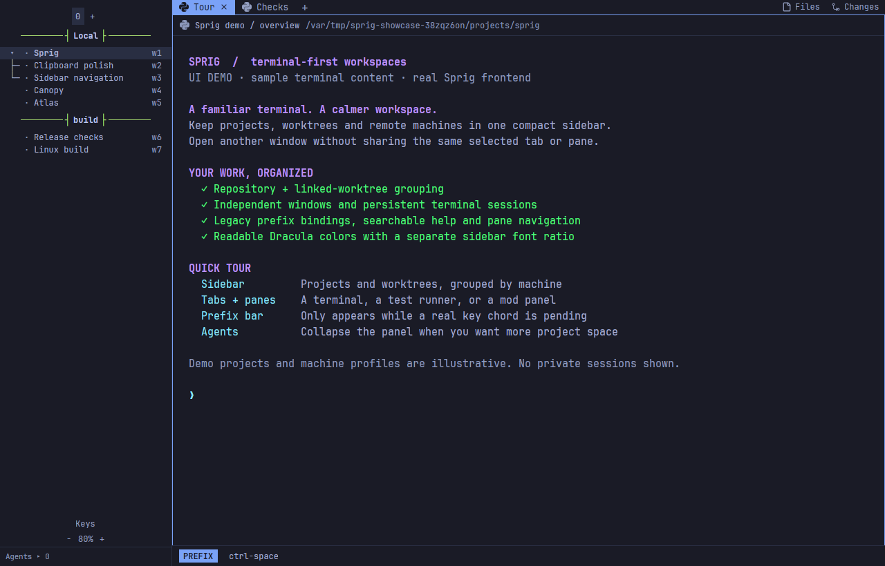
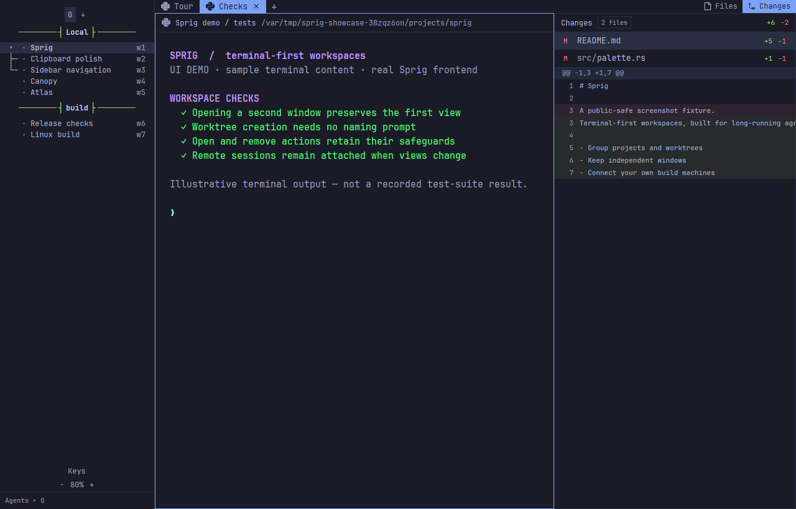
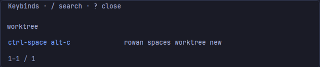

# Sprig

**Grove's terminal-first frontend for long-running agent work.**

A native desktop app with the feel of a terminal workspace: compact project and
worktree navigation, independent windows, familiar prefix keys, and terminals
that keep running in **herdr-core** when you close the frontend.

[Download a preview](https://github.com/JSRRosenbaum/grove-sprig/releases/tag/sprig-preview-2026.11.03.2) ·
[Setup](#get-sprig) · [Controls](#navigation-and-keys) ·
[Customization guide](sprig/README.md) · [Development](#build-from-source)



*Actual Sprig rendering in an isolated demo session. Projects, machine profiles
and terminal output are illustrative—not private conversations or live agent
results. The `build` profile connects a second private core on the demo host.*

> **Development preview, not a stable upstream release.** Active implementation
> is on [`feat/legacy-keybinding-parity`](https://github.com/JSRRosenbaum/grove-sprig/tree/feat/legacy-keybinding-parity)
> ([PR #1](https://github.com/JSRRosenbaum/grove-sprig/pull/1)). The screenshots
> use the `2fe333f` frontend with `b3e4da0` customizations. The downloadable
> `2026.11.03.2` snapshot predates the latest worktree customization fixes.

## What makes it Sprig?

- **A compact sidebar, not a dashboard.** Group workspaces by machine and
  repository; nest linked worktrees beneath their project. Stable `w…` tags,
  tree gutters and status marks stay visible without appending branch names.
- **Independent windows.** Open a second window on the same running terminals
  without forcing both windows onto the same workspace, tab, pane or zoom.
- **Legacy-style keyboard navigation.** Import your Herdr TUI profile. The
  native **PREFIX** indicator appears only while a chord is pending, beside
  the sidebar rather than across it. Search the effective key guide instead
  of memorizing a second shortcut scheme.
- **Worktrees without a naming chore.** On the current development branch,
  **New worktree** immediately creates an automatically named branch and its
  workspace. Open keeps its checkout picker; Remove keeps its confirmation.
- **Less chrome when you want it.** Collapse Agents, resize the sidebar and
  adjust its font ratio independently of terminal text. Files and Changes
  panels can sit beside the terminal or be put away.
- **A native terminal frontend.** Run coding-agent TUIs, shells and ordinary
  terminal programs. Inline Kitty graphics, terminal links and clipboard
  integration are part of the app—not screenshots substituted for a terminal.

## A workspace you can inspect

A **herd** groups machine profiles. Each machine has **workspaces** (called
*spaces* in the API), each workspace has **tabs**, and each tab can contain
terminal **panes** or mod panels.

The sidebar can drag-reorder workspaces within a machine and fold project
children. Repository/worktree membership is remembered in the source core,
so reopening a frontend need not rediscover every checkout before grouping it.



*The Changes panel above is reading actual changes in the demo Git repository.
Its diff is not terminal artwork. The terminal text is sample content.*

### Navigation and keys

Use the imported profile's prefix to navigate workspaces, tabs and panes. The
**Keys** control opens the guide; `/` searches its effective bindings. Your
profile—not a screenshot's shortcut—is the source of truth.



*Native key-guide detail, cropped from the demo window. This example profile
uses Ctrl+Space followed by Alt+C for New worktree; imported bindings can differ.*

Numbered tabs are supported: set `[ui] prompt_new_tab_name = false` in your
authored legacy profile before installing it. Rename a tab later when a title
would help. See the [customization guide](sprig/README.md) for profile precedence,
remote-source commands, mouse behavior and the full navigation model.

### More than one window, more than one machine

Launch `herdr-app` again for another independent window. The windows share
configuration and core workspace structure, not one selected viewport. Opening
a second window does not start another copy of an agent.

Add your own SSH machine profiles through Settings or the sidebar. Terminals
run on their source machine; a sleeping laptop or closed frontend does not stop
the remote work while that machine and its core remain running.

**Closing a frontend leaves terminals running. Closing a pane or tab ends its
terminals.** After a host reboot or core crash, kept terminals can recover as
fresh shells; they do not magically resume the old processes.

## Get Sprig

Start with the [unsigned development packages](https://github.com/JSRRosenbaum/grove-sprig/releases/tag/sprig-preview-2026.11.03.2),
not the official Herdr updater. The archives include the app, paired core,
customizations, native annotation/review tools, licenses and checksum manifests.

| Package | Requirements and limits |
| --- | --- |
| Windows x64 ZIP | Python 3.11+ for verification/setup. Keep the packaged ConPTY files in their relative locations. Unsigned preview, not a one-click installer. |
| Linux x86-64 archive | glibc **2.44+**, system graphics/font libraries and Python 3.11+. Not a generic NixOS or portable older-distribution package. |
| macOS / ARM | No downloadable build in this preview. |

1. Extract to a **new, versioned directory**, preserving the working installation.
2. Verify the archive against the release's `SHA256SUMS`; run
   `python Verify-Package.py` inside the extracted package (`python3` on Linux).
3. Follow **`INSTALL-LAPPY.md`** in the Windows ZIP or **`INSTALL.md`** in the
   Linux archive. They cover the paired core path, native tools, profile import,
   launcher updates and rollback. On Windows, update taskbar pins as well as
   Start menu shortcuts, and install as the desktop user.
4. Update the **frontend and its matching customization bundle together**.
   Recent hierarchy mods require APIs absent from older frontends. Reopen only
   the frontend after installation; do not stop live agents or core holders.

The packages are not release-qualified: repository Actions is disabled, and
full Windows physical-interaction qualification remains incomplete. Exact
provenance and exercised checks live in the
[release notes](https://github.com/JSRRosenbaum/grove-sprig/releases/tag/sprig-preview-2026.11.03.2)
and [integration record](docs/sprig.md). Do not substitute older test results
for qualification of a newer binary.

## Install or update Sprig customizations

Already using the matching Sprig frontend? The same repository contains the
layout, mods, theme and legacy-key compiler—no second customization fork needed.
For the current development version:

```sh
git clone --branch feat/legacy-keybinding-parity --recurse-submodules \
  https://github.com/JSRRosenbaum/grove-sprig.git
cd grove-sprig
python3 sprig/install.py --legacy-config /path/to/your/authored-config.toml
herdr-app windows
herdr-app --window 1 do layout.switch --name rowan-terminal
```

Use a window ID returned by `windows`; do not assume that `1` is your desired
window when several are open. On Windows use `python` for the installer.
Omit `--legacy-config` only when you intend profile discovery or original
defaults. Existing authored profiles should be reused on subsequent installs.

**Legacy keys replace global and terminal captures**, rather than merging
newer bindings that might steal program input. Existing files are backed up.
Settings, machine connections, running terminals and unrelated extensions are
preserved. The installer does not migrate sessions, copy credentials or restart
apps/cores. Do not edit the same files concurrently with an install.

After a fast-forward update, rerun the installer with the same profile. Use
`--legacy-machine-config NAME=PATH` for explicitly imported source profiles;
`--app-home`, `--agent-home` and `--backup-home` select alternate roots.
[Full installation and rollback details →](sprig/README.md#install)

## Make it yours

A **layout** arranges the native window. **Mods** are trusted JavaScript programs
that draw panels, menus and dialogs. Save personal layout, mod or key files to
reload them; a broken edit retains the last good version and reports an error.
Duplicate shipped layouts/mods before changing their structure.

The app's executable and installed state still use `herdr-app`, `rowan-terminal`
and `rowan-*` names for compatibility. The project name is Sprig; those stable
runtime IDs are not a second installation.

Ctrl+Shift+P shows every command and its key (Cmd+Shift+P on macOS). Change any key in `keys.json`; see [the keys section](defaults/AGENTS.md#keys-keysjson) of the mod guide for the format, including JSON objects for named, typed command arguments.

Mods have command and network access; they are **not sandboxed extensions**.
Review third-party code before installing it. Telemetry can be disabled in
Settings → Privacy. See [security and privacy](docs/security.md).

## For agents

Use herdr-core to run and coordinate programs; use the frontend to change what
the person sees. Inspect before changing a live view:

```sh
herdr-app --skill
herdr-app windows
herdr-app --window 1 status
herdr-app --window 1 ls
herdr-app commands
```

An ambiguous or unavailable window target fails rather than guessing.
[Command reference](docs/commands.md) · [Layouts and mods](docs/mods.md)

## Build from source

The native Rust app is at the repository root; `sprig/` contains its supported
customization bundle and legacy integration. Build instructions and system
prerequisites are in [Contributing](CONTRIBUTING.md) and the
[CI workflow](.github/workflows/ci.yml).

```sh
just build
just test
just install
```

`just test-sprig` runs customization checks. `just docs-check` checks generated
references and CLI examples. For maintainers, build on Ash rather than the live
Rowan workstation; deploy deliberately without restarting someone else's
frontend, core or agents. Source builds do not update themselves.

Documentation checks also need [Bun](https://bun.sh): `just docs-check` checks generated pages and CLI examples; `just docs-generate` refreshes the reference pages.

To compare drawing changes on Windows, Linux or macOS, run the same fixed workloads against each build:

```sh
python scripts/bench.py --bin <app executable> --set spinners --seconds 20
```

The runner requires `hc` on PATH and uses the Python executable running the script. It prints a unique artifact folder with the run settings, counters and results, then stops its private app, terminals and core. Every set uses Python fixture programs; the default set’s TUI workload replaces historical `btop` measurements. `--only spinners` measures just the quiet native spinner scenario. `--set titles` runs eight agents whose titles spin after a prefix (`π ⠹ task`) on the main layout. Keep the window visible and the display awake, and compare the same window activity and display settings; inactive windows may draw at a lower rate. Windows records visibility, foreground activity and display Hz at each measurement boundary; other platforms mark these observations unavailable. Visibility does not establish occlusion. Draws are window render calls. Render-to-paint elapsed time stops before scene finalization, backend drawing, uploads and presentation; it is separate from OS process CPU time. Neither measures physical presentation or the FPS HUD’s derived MAX FPS.

`python scripts/bench_compare.py ghostty --root <artifact folder>` reuses a run’s fake agent for the macOS comparison. Benchmark checks: `python -m unittest discover -s scripts -p test_bench.py`.

## Credits and provenance

Sprig is an **unofficial fork**, based on
[Herdr app](https://github.com/herdrdev/herdr-app), herdr-core, and
[Kyle Avrett's Square Dracula](https://github.com/kyle-avrett/herdr-square-dracula).
It consolidates the app/layout histories rather than maintaining two divergent
customization repositories.

[License](LICENSE) · [Third-party notices](THIRD-PARTY-NOTICES) ·
[Imported revisions and upgrade boundaries](docs/sprig.md)
