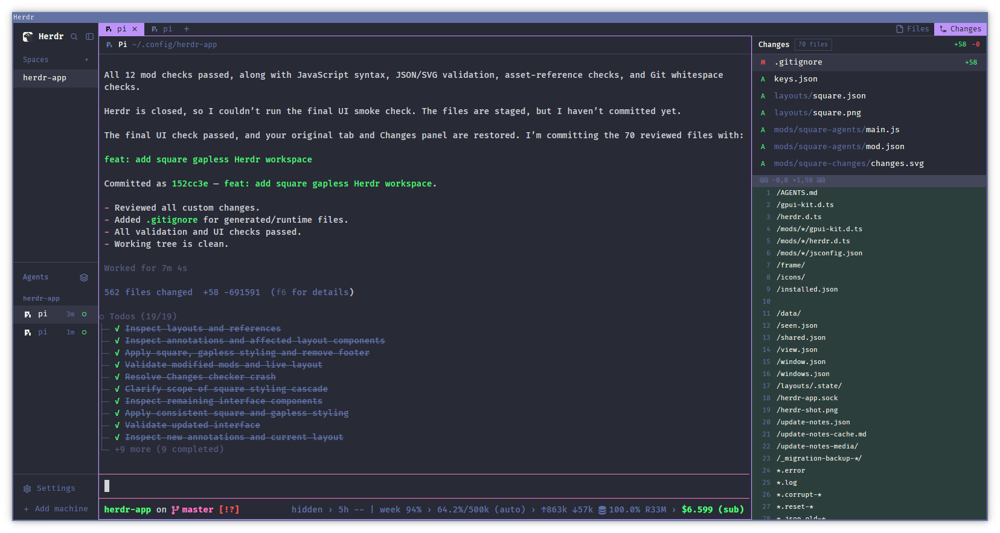

# Square Dracula

A native Herdr workspace with a narrow spaces-and-agents sidebar, compact tabs, square
terminal panes, and a Files or Changes panel. Dracula colors carry across the interface;
active tabs use the lavender pane-border color. Panels meet without gutters, terminal
padding is zero, and readable padding remains inside controls.



## What you see

- A 140 px sidebar on the left, adjustable between 44 and 480 px. Its 46 px brand row has
  Herdr, search, and collapse controls. Spaces and Agents share the remaining height with
  equal weights and 90 px minimums. Space rows have names but no colored avatar.
- A 76 px sidebar footer contains Settings and Add machine. Its top border has a 7 px inset
  before the two 34 px control rows. There is no bottom "This computer" status bar.
- A 21 px tab strip above the workspace uses a 20 px text line. The new-tab `+` follows the
  last numbered or named tab. Files and Changes toggles sit on the right. Active tabs and
  active panel toggles use `#BD93F9` with `#282A36` text.
- Each terminal pane has a 30 px header, 12 px title text, a one-pixel border, square corners,
  zero split gaps, and no terminal padding. The focused border is lavender; other borders
  use `#44475A`. Active tab fill meets the pane border without a one-pixel color break.
- The right panel starts at 389 px wide, can resize between 280 and 900 px, and initially
  shows Changes. Files and Changes headers are both 30 px tall with 12 px medium-weight
  titles, matching terminal headers. Their content uses 13 px text; diffs use 11 px text.
- The look is dark: `#282A36` backgrounds, `#21222C` canvas, `#F8F8F2` foreground,
  `#6272A4` muted text, `#424450` hover, and `#353747` selected list rows. Borders are
  `#44475A`. Terminals use Fira Code at 14 px; the interface also requests Fira Code.
- Menus, fields, selection rows, and buttons have square corners. Icon-label spacing and
  text padding remain. Status dots, rings, and spinners retain their semantic shapes.

## How it behaves

### Agents and status

- Working agents show a yellow `#F1FA8C` spinner, animated natively with a 900 ms rotation.
- Blocked agents show red `#FF5555` attention: a "Needs you" badge, or a compact exclamation
  mark when a priority section already supplies that label.
- Done agents show a lavender dot. Herdr turns done into idle after the person looks; the
  agent list holds the viewed item in its Done section until they leave it.
- Idle agents show a green `#50FA7B` outlined ring. Agent rows show elapsed status time.
- The list supports grouped-by-space and priority ordering, collapsible groups, pinning,
  and nested sub-agents. Its sort control opens a square popup. The list supplies
  `agent.next` and `agent.prev` navigation order to Herdr.
- Tabs show working spinners and blocked/done dots. Herdr's aggregate urgency remains
  blocked, then done, then working, then idle.

### Spaces, tabs, and panes

- Clicking a space or tab selects it. Right-clicking opens its menu. Tabs can be renamed
  by double-clicking; tabs and spaces can be reordered by dragging between rows/items.
- The `+` menu starts a shell or an installed agent, creates a space, or opens worktree
  creation and selection dialogs. Its existing Ctrl-number, Ctrl-T, and Ctrl-N actions
  remain available while that menu has focus.
- Clicking a pane header focuses it. Hovering reveals adjacent square buttons for splitting
  right or down, zooming, and closing that specific pane.
- Herdr's native split resizing and pane-grip dragging remain enabled. Zoom and focus still
  belong to Herdr; the layout does not create a separate terminal model.
- Pane right-clicks act on the clicked pane and terminal, not an inferred focused target.
  Shift-right-click remains Herdr's escape hatch when a program takes mouse input.
- The search button opens the square picker. Typing filters tabs, spaces, and agents;
  arrows and Enter navigate, Escape closes, and Ctrl-D retains the picker's close-tab action.
- The optional `layout:square-dracula` keyboard section in README binds Ctrl-Shift-K and
  Ctrl-X then L to the same picker without replacing bindings in other layouts.

### Panels and dialogs

- Files and Changes toggles open, switch, or close the right panel. Its selection is stored
  per space in the tabs mod's local storage.
- Files follows the focused terminal's folder. Clicking a directory expands it; clicking a
  file opens a read-only preview, with a back control to return to the tree.
- Changes follows the focused repository, lists changed files and line counts, and previews
  the selected diff. Clicking a selected file can close its preview. There is no commit
  input, commit button, or commit mutation path in this mod.
- Local repository changes are watched; remote folders use polling. Slow work runs through
  Herdr's asynchronous `exec`/`hc` interfaces rather than blocking rendering.
- Worktree dialogs retain creation, opening, and explicit removal. Checkouts are placed
  under `~/.herdr/worktrees/<repo>/<branch-slug>` on the space's machine.
- Add machine lists `~/.ssh/config` entries and accepts a typed SSH target. Explicit Add
  actions invoke `hc machine add`; interactive authentication opens its terminal window.
- Settings, the palette, confirmations, help, terminal peeks, and notifications remain
  app-owned interfaces rather than being replaced by this layout.

## Built from

The single-layout gallery folder is this repository root: `layouts/square-dracula.json`,
its `mods/square-dracula-*` folders, this recipe, and `preview.png`.

The layout is a clone of Herdr's `main` tree with a fixed dark Graphite base and embedded
Dracula overrides, fonts, and opacity. Global `settings.json` is not needed for its look.

```text
root: row
  sidebar: column, 140 px
    brand: square-dracula-workspace-chrome
    sidebar-lists: column
      spaces: square-dracula-spaces
      agents: square-dracula-agents
    sidebar-footer: square-dracula-workspace-chrome, props.footer = true
  work: column
    tabs: square-dracula-tabs, 21 px
    work-body: row, zero padding and gap
      main: active tab, square-dracula-pane headers
      panel: column, 389 px
        panel-body: stack
          files: square-dracula-files
          changes: square-dracula-changes
```

- `square-dracula-workspace-chrome` draws the brand and footer. Its non-footer copy handles
  picker commands; both copies share collapse state. It opens the picker and machine dialog.
- `square-dracula-spaces` lists spaces, groups remote machines, and obtains repository and
  worktree information through git. `square-dracula-agents` lists agents and sub-agents,
  maintains pin/sort state, and provides the sort-menu role through `props.sortMenu`.
- `square-dracula-tabs` renders tabs and panel toggles, remembers panel choices, and opens
  the new-work and context menus. `square-dracula-pane` is instantiated per pane with
  `props.pane` and `props.terminal` for its title, folder, status, and targeted buttons.
- `square-dracula-files` provides the read-only tree/editor. `square-dracula-changes`
  provides changed-file rows and a virtualized, horizontally scrollable diff.
- `square-dracula-menu` uses `props.tab` and `props.target` for pane, tab, and space menus.
  `square-dracula-new-menu` lists shells, installed agents, and worktree actions.
- `square-dracula-picker` provides the searchable workspace popup.
- `square-dracula-worktree` receives `space`, `folder`, and `action` props for new, open, or
  remove workflows. `square-dracula-machine-add` draws both its dialog and an authentication
  window title bar selected by `props.part = "bar"`.

The mods use gpui-kit `View`, element builders, native animation, and gpui-base inputs,
scrollbars, virtual lists, and read-only editors. Live data comes from `spaces`, `panes`,
`agents`, `terminals`, `machines`, `focused`, `theme`, `settings`, and `window`. Shared values,
local storage, and `setAgentOrder` retain app state and navigation order.

Actions use Herdr's space/tab/pane commands, `terminal.peek`, `app.settings`, and
`layout.resize/show/hide/select`. Explicit popups use `openOverlay({frame: "none"})` and
`closeOverlay`. Background work uses `exec`, `hc`, `readTextFile`, and `watchFolder`.

Programs invoked include git and hc, plus sh or PowerShell for platform-specific folder
and home discovery. A remote Mac's permissions action can invoke `open`. There are no
`fetch()` calls. Machine actions can still communicate over SSH through herdr-core.

The mod folders include their copied SVG assets. Other program/UI icons come from Herdr's
shipped `icons/`, `mods/workspace-chrome/`, `mods/pane/`, `mods/files/`, and `mods/changes/`.
The brand image is `frame/welcome/herdr.png`. The user's provided screenshot is kept at the
root for the gallery and copied into the chrome mod for the in-app Settings preview.
Source and icon provenance is recorded in LICENSE, NOTICE, and each mod's clone metadata.

## Watch out

- Built against Herdr 0.1.7's APIs and shipped assets. The files are an installation overlay,
  not a standalone terminal application; launch Herdr once before installing them.
- Fira Code is not bundled. Font fallback, window size, zoom, existing spaces, and terminal
  programs can differ from the screenshot. The theme picker can deliberately override the
  layout's embedded theme.
- Do not copy the author's `settings.json` or `keys.json` over another person's files merely
  to install the layout. README documents a small optional layout-scoped key section.
- Existing shared `workspace.panels` preferences can hide Files or Changes toggles. Per-space
  panel choices, agent pins, and sidebar collapse state are runtime data, not gallery files.
- The Settings footer's 7 px top inset matches the author's single-line Pi input divider;
  it does not inspect terminal pixels or track another program's internal UI.
- Herdr 0.1.7 hard-codes a rounded frame around native terminal menus. The custom menu first
  replaces that host popup with a frameless copy, guarded by `props.frameless`, and draws
  one square border itself. Preserve `props.target` and use the new overlay ID when closing.
  Replacement samples the current pointer, so moving it during opening can change placement.
- Do not materialize an empty Changes virtual list: the standalone Herdr checker crashes on
  that case. The mod only constructs the diff list and scrollbar when rows exist.
- Files limits each folder to 500 entries, the tree to 5,000 entries and 40 levels, and editor
  text to 400,000 characters. Changes limits status results to 1,000 files, previews to
  1,500 lines, and individual diff lines to 4,000 characters. Herdr also bounds file reads.
- Rebuilding a copy must not accidentally restore rounded native popup frames, the removed
  status bar, space avatars, commit controls, or terminal gutters. Internal text/icon
  spacing and semantic status dots are intentionally retained.

## Done when

1. Every `mods/square-dracula-*` folder passes `herdr-app check`, and switching to
   `square-dracula` leaves `herdr-app status` with no errors.
2. A fresh installation shows the Dracula look without copying the author's settings file.
3. The active tab and terminal border form a continuous lavender shape; active Files and
   Changes toggles use the same fill and readable dark foreground.
4. Multiple tabs have adjacent square edges, and `+` follows the last tab rather than the
   right-side panel controls.
5. Terminal splits meet without gaps; terminal content has zero app-added padding; Files,
   Changes, and terminal headers match in height and title size.
6. Space rows have no avatars, the bottom status bar is absent, and Changes has no commit row.
7. Right-clicking a pane produces exactly one square-framed menu; Escape dismisses it, and
   actions still target the pane that was clicked.
8. Search opens one square picker. If the optional keys are installed, both shortcuts open
   that same picker only while this layout is active.
9. Files expands directories and opens a read-only preview; Changes displays a real diff.
10. The in-app layout preview loads from the chrome mod, other layouts remain available,
    and installation has not overwritten any shipped mod or global preference file.
