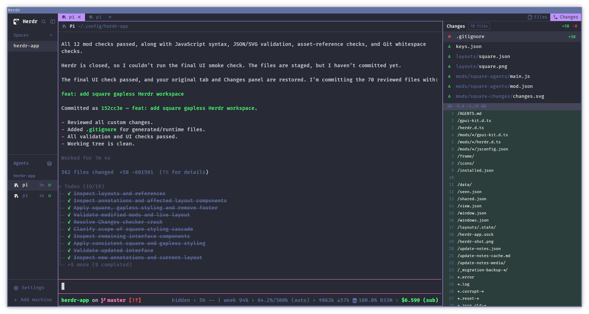

# Sprig customization bundle

The compact Rowan terminal interface, based on
[Kyle Avrett's Square Dracula](https://github.com/kyle-avrett/herdr-square-dracula).
This directory and the native app are maintained together in
[JSRRosenbaum/grove-sprig](https://github.com/JSRRosenbaum/grove-sprig).
No personal machine connections, credentials, or running-session state are included.
The app at the repository root provides independent windows and the native
prefix/help patches. Runtime `rowan-*` and `square-dracula-*` names are retained
for installed-state compatibility; a second fork checkout is no longer needed.



## Requirements

- Herdr and herdr-core installed and working. Built from Herdr 0.1.7's shipped layouts
  and mods.
- Git, used by the Files, Changes, Spaces, and worktree panels.
- Fira Code for the intended terminal and interface typography. It is not bundled; Herdr uses
  its available fallback fonts when it is missing.

The layout carries its own Dracula colors, fonts, and terminal padding. Installing it does
not require replacing your global settings or keybindings.

## Install

From the **Sprig repository root**:

```sh
python3 sprig/install.py
herdr-app do layout.switch --name rowan-terminal
```

See the [root installation guide](../README.md#install-or-update-sprig-customizations)
for alternate configuration roots, backups and the update/rollback contract.
The installer includes all eleven mods used by `rowan-terminal`; it does not
overwrite global settings or install the author's personal snapshots in
`settings.json` / `keys.json`. It preserves existing global and terminal keys
and seeds platform defaults when `keys.json` is missing.

The original Square Dracula layout and assets remain in this directory as
attributed source, but the supported installer installs the compact Rowan layout
and its explicit dependency set. Original standalone-layout installation
instructions remain available in the [upstream repository](https://github.com/kyle-avrett/herdr-square-dracula).

## Controls

- Select a space or tab by clicking it; right-click for its context menu.
- The `+` after the last tab opens terminal, agent, space, and worktree actions.
- Files and Changes buttons open, switch, or close the right panel. The choice is remembered
  per space. Files previews and Changes diffs are read-only; there is no commit-entry row.
- Hover a terminal header to reveal split-right, split-down, zoom, and close buttons.
- The sidebar search button opens the picker; Escape dismisses it.
- Pane context menus have one square frame, including on Herdr 0.1.7.

Settings, the command palette, confirmation dialogs, notifications, and terminal programs'
internal interfaces remain Herdr's or the program's own UI.

## Update or remove

Pull `grove-sprig/main` with `git pull --ff-only` and rerun
`python3 sprig/install.py` from the repository root. The ownership manifest
prevents removal of unrelated files. Existing settings and machine/session state
are not replaced. Do not run another installer concurrently.

To remove the customization, first switch the selected window to another layout.
Use `.rowan-install-manifest.json` in your app home to identify the installed
files; preserve unrelated files and personal keybindings. Backup manifests map
the replaced files to their saved copies. Terminals and workspaces belong to
herdr-core, not to this layout.

## What the mods access

These are modified versions of Herdr's shipped mods and run with your user permissions.
They inspect live spaces, tabs, agents, folders, and git repositories. The machine dialog
reads `~/.ssh/config`; adding a machine can connect over SSH through `hc`. Worktree actions
create or remove checkouts only when explicitly invoked. There are no `fetch()` calls or
custom HTTP polling loops in these mods.

## Rowan terminal sidebar

The installed `rowan-terminal` layout ports the compact-herds sidebar behavior from
Joseph's Herdr TUI fork without changing the terminal renderer or moving any programs.
It uses `rowan-spaces`, `rowan-agents`, `rowan-empty`, and the herd-scoped `rowan-picker`.

```sh
python3 sprig/install.py
herdr-app check ~/.config/herdr-app/mods/rowan-spaces
herdr-app check ~/.config/herdr-app/mods/rowan-agents
herdr-app check ~/.config/herdr-app/mods/rowan-empty
herdr-app check ~/.config/herdr-app/mods/rowan-picker
herdr-app do layout.switch --name rowan-terminal
```

The installer updates its owned Square Dracula dependencies, Rowan mods/theme/layout,
and OMP display companion. It merges the Rowan layout's key section while preserving
unrelated bindings, terminal overrides, settings, zoom, and machine configuration.
Existing files are backed up under `~/.local/state/herdr-app/rowan-sidebar-backup-*`;
each `manifest.json` maps destination paths to their original numbered copies.
Use `--app-home` / `--agent-home` for explicit alternate installation roots.

- Numbered herd tabs retain empty herds. `+` adds one. Right-click a machine heading
  to move that profile to a herd; click a heading to fold it.
- Drag a **machine heading** onto another heading to reorder whole sections within
  the current herd, including Local. An accent line marks the destination; dropping
  outside the sidebar cancels. Right-click a heading for **Move section up/down**.
  Folded and offline sections can also be reordered. The order is saved per window
  and herd, survives profile rename and reload, and drives workspace keyboard
  navigation. Existing orders migrate once from Local-first/alphabetical ordering;
  newly discovered profiles append without reshuffling existing sections.
- The sidebar follows the legacy terminal reference: centered herd tabs, centered
  green machine separators, and dense single-line workspace/branch rows,
  left status marks and right-aligned IDs. The large brand/footer blocks are absent;
  machines use the available area while Agents is collapsed, or four fifths when expanded.
  The `main` branch suffix is hidden; other branch names remain visible.
- Secondary UI text is deliberately readable: the Rowan layout owns `muted`
  (`#929dbf`), `dim` (`#8b97ba`), and `unknown` (`#929dbf`) color overrides.
  Both secondary text colors exceed 4.5:1 against the selected-row background;
  these are UI-only overrides, not terminal ANSI or SGR dim changes. Machine-title
  caps use the same green as their horizontal rules, with a brighter title.
  Keeping these overrides on the layout also forces live refresh: the current app's
  `settings::set` ignores a changed theme file when its settings compare equal.
- Repository folding lives on the parent workspace's chevron instead of a duplicate
  repository-heading row; the selected child remains visible. Expanded rows reserve
  a fixed gutter for fold chevrons and tree branches **before** the status mark,
  keeping status marks and workspace names aligned even on ungrouped rows.
  Collapsed parents roll up hidden child attention. Drag a workspace row onto another row to reorder it
  within the same machine; an accent line marks the destination and the active
  workspace stays selected. Order is stored by Herdr Core, not a separate sidebar
  list; repository/worktree grouping still applies. Reorder arrows remain on hover.
  Releasing outside the sidebar cancels. Offline or cross-machine drops do nothing.
- `w1`, `w2`, … are persistent **display aliases**, not core/API workspace IDs.
  They remain bound to the full machine-profile/space identity across row reordering,
  reload, and profile rename. Separate profiles on one host are not merged.
- Ctrl+Alt+Up/Down cycles workspaces in the selected herd; Ctrl+Alt+Left/Right switches
  herds and restores the remembered live space/tab/pane. Alt+1…9 selects by displayed
  workspace order; Alt+Up/Down cycles that herd's agents.
- Empty/unavailable selections show a non-terminal surface. The Rowan layout guards
  implicit create/rename, tab, pane, and paste shortcuts from acting on an off-herd
  workspace. Explicit external core commands remain independent of this UI.
- Agent rows retain priority/grouping, pins, nested agents, and authoritative activity.
  The panel starts collapsed: click the bottom `Agents ▸ N` strip to expand it and
  the `Agents ▾ N` header to collapse it. This preference survives reloads; scoped
  agent navigation continues to work while the panel is collapsed.
  Newly launched OMP sessions publish session title, resolved provider/model, context
  percentage, and measured last-turn cache-read/write counts when available.
  No quota limit or cache-warmth estimate is invented.
- The companion is `~/.omp/agent/extensions/rowan-omp-display.ts`. Existing OMP processes
  are not restarted or injected into; `/reload-plugins` does not load new hook code.
  Missing data is omitted. Labels are accepted only for a matching live OMP foreground
  PID and expire after ten minutes without a report. This is display metadata, not a
  lifecycle/session identity authority or a replacement for Herdr's managed hook.

### Sidebar text size and panel controls

The centered `− 80% +` controls at the bottom of the workspace sidebar pane adjust sidebar text
as a fraction of the terminal's configured font size, independently of global zoom. The default is **80%**
(previous compact text was about 67% with the nominal 15-unit terminal font).
`−` / `+` change it in five-percentage-point steps from 60% to 120%; click the percentage
to reset to 80%. Workspace rows and agent typography scale with it; the saved ratio
follows later terminal-size/zoom changes without changing those settings itself.

Equivalent native mod commands:

```sh
herdr-app do rowan-spaces.font-ratio:100
herdr-app do rowan-spaces.font-smaller
herdr-app do rowan-spaces.font-larger
herdr-app do rowan-spaces.font-reset
herdr-app do rowan-agents.panel-toggle
herdr-app do rowan-agents.panel-expand
herdr-app do rowan-agents.panel-collapse
```

Preferences are persisted through Herdr shared state (`rowan.sidebar.fontRatio`,
`rowan.agents.collapsed`), not by changing terminal settings or writing layout state
files directly. Collapsing the panel does not stop or hide the agents from navigation.

### Ctrl+Space prefix

Herdr-app's native GPUI keymap accepts space-separated chords, not the TUI's
`prefix+...` keyword. The Rowan key overlay translates the configured Ctrl+Space:

| After Ctrl+Space | Action |
|---|---|
| `c`, `r`, `k` | New, rename, close tab |
| `v`, `h` | Split right, down |
| `Alt+arrow` | Focus adjacent pane |
| `Shift+C`, `Shift+R`, `Shift+K` | New, rename, close workspace |
| `s` | Ready workspaces/tabs in the current herd |
| `Shift+S` | Settings |
| `f`, `?` | Help |
| `d` | Detach this window; core terminals keep running |
| `Escape` | Cancel |

Standalone Ctrl+Space is consumed. With the Rowan native keyboard build, its
Escape continuation holds the real GPUI prefix until completion or cancellation;
a visible PREFIX indicator stays on while armed. Escape, unmatched continuation,
focus change and OS-window deactivation clear it. Ordinary unrelated chords retain
their native timeout. Terminal-specific overrides remain more specific than layout keys.

Direct **Alt+Left/Right** switches tabs; **Alt+1…9** selects a tab.
**Alt+Shift+Left/Right** reorders the exact live focused tab within its workspace,
with no action at an edge, stale focus, unavailable machine, or off-herd workspace.
**Ctrl+Alt+Up/Down** switches workspaces; **Ctrl+Alt+Left/Right** switches herds.

The centered **Keys** footer button (also available as `?` in the compact sidebar)
opens the searchable guide; the centered font-ratio control remains at the bottom.
The guide resolves terminal > current layout > global bindings, labels mod-only
bindings, and searches readable action names as well as shortcut text.

Explicit reload, resize mode, worktree/workthreads and annotation/plugin commands
remain unported rather than being assigned unrelated substitutes. Configuration
edits still hot-reload normally.

Keyboard qualification on 2026-10-31 used the actual Ash-built native app on a
private Sway/XWayland display: Ctrl+Space held beyond one second; `f` and `?`
opened help; filtering, Escape/unmatched cancellation, OS deactivation without
focus loss, tab selection/reordering, workspace/pane navigation, footer discovery,
and detach without killing core terminals all ran through real input delivery.
No synthetic input was sent to the person's desktop.

Behavior checks:

```sh
node --experimental-vm-modules --test mods/rowan-spaces/navigation.test.mjs mods/rowan-agents/consumer.test.cjs mods/rowan-picker/consumer.test.cjs
```

Rowan qualification on 2026-10-30: 22 behavior tests passed; all four mods have passed
native checks (the changed spaces/agents checked again after the controls update).
Real app commands exercised repository folding/navigation, machine membership,
empty-herd guards, exact selection restoration and stable labels after hot reload.
A fresh OMP published provider/model/context with zero model turns; measured cache
formatting and stale-data rejection were covered by isolated behavior tests.
The live app exercised panel expand/collapse, 95%/100%/80% ratio changes and saved
preferences surviving mod reload; main font/zoom/key/settings files stayed unchanged.
The existing OMP and shell PIDs survived unchanged. No Rust rebuild, legacy Herdr/Tern
cutover, fleet deployment, or model request was part of this sidebar installation.

To leave the sidebar immediately: `herdr-app do layout.switch --name square-dracula`.
For the exact prior Rowan appearance and keys, restore the files listed in the first
installation backup's manifest; keep backup originals until the result is verified.

## Gallery and recipe

[RECIPE.md](RECIPE.md) describes Square Dracula's interface, implementation, limitations, and acceptance checks.
This repository keeps the original Square Dracula recipe, screenshot, `layouts/`, and
`mods/` together at its root and uses the GitHub topic `herdr-layout` for gallery discovery.

[herdr.dev/layouts](https://herdr.dev/layouts/) handles indexing and screenshot moderation;
a published repository may not appear immediately.

## Attribution

The layout and mods are modified from [Herdr 0.1.7](https://github.com/herdrdev/herdr-app),
under the [Apache-2.0 license](LICENSE). [NOTICE](NOTICE) records the changes and the Lucide
and Feather icon licenses. Program icons and the Herdr brand image are supplied by your
Herdr installation, not copied into this repository.
